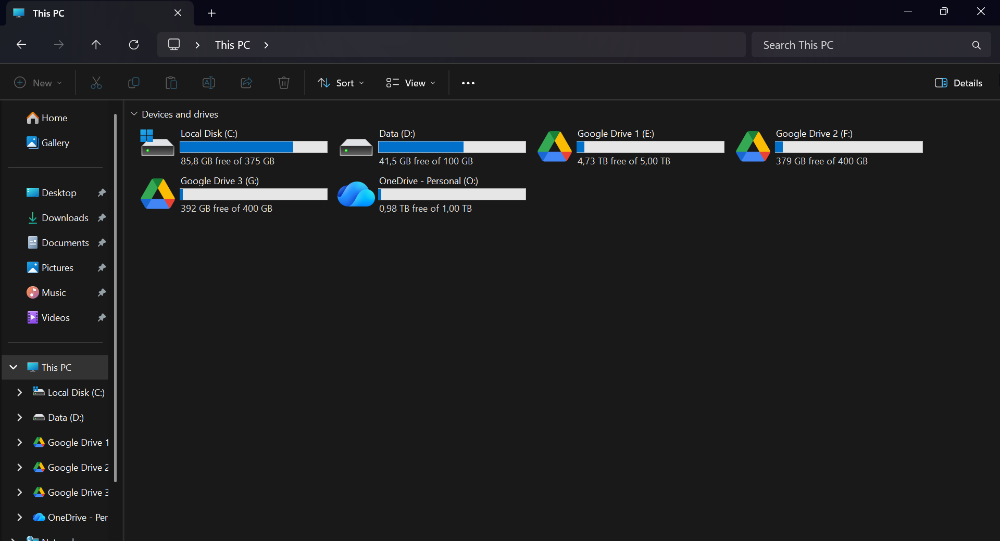

<div align="center">

# WinCloudMount 🚀

### *Orkestrator Virtual Cloud Drive Performa Tinggi & Hemat RAM untuk Windows.*

Mount akun Google Drive, OneDrive, Nextcloud, Mega, Dropbox, dan S3 tanpa batas sebagai drive lokal Windows (`E:`, `F:`, `G:`, dst.) dengan fitur drag-and-drop penuh, cache VFS super cepat, icon resmi provider, dan tanpa aplikasi latar belakang yang berat.

<p align="center">
  <a href="LICENSE"></a>
  <a href="https://microsoft.com/windows"></a>
  <a href="https://winfsp.dev"></a>
  <a href="docs/BENCHMARKS.md"></a>
  <a href="CONTRIBUTING.md"></a>
</p>

🌐 [English](README.md) • [Bahasa Indonesia](README.id.md)

[ 🚀 Panduan Cepat ](#-panduan-cepat-kurang-dari-5-menit) • [ 🎨 Provider & NAS yang Didukung ](#-bundel-icon-resmi--auto-detection) • [ 📊 Perbandingan Performa ](#-mengapa-wincloudmount-dibanding-aplikasi-komersial) • [ 🗑️ Panduan Uninstall ](#️-prosedur-uninstall-pembersihan-tuntas)

---

<p align="center">
  
</p>

---

</div>

## ⚡ Mengapa WinCloudMount Dibanding Aplikasi Komersial?

Software komersial seperti **Air Live Drive** atau **RaiDrive** membatasi fitur pada versi gratis (maksimal 1 drive, kecepatan dibatasi, popup lisensi) dan memakan RAM ratusan megabyte karena menggunakan framework .NET/WPF atau browser Chromium di background.

| Fitur / Metrik | Air Live Drive (Free) | RaiDrive (Standard) | **WinCloudMount** |
| :--- | :--- | :--- | :--- |
| **Batas Drive Simultan** | **1 Drive (Terkunci Lisensi)** | 4-8 Drives | **Unlimited (Bebas Tanpa Batas)** |
| **Konsumsi RAM saat Idle** | ~250 MB – 400 MB | ~180 MB – 300 MB | **~25 MB – 35 MB per drive** |
| **Penggunaan CPU saat Idle** | 0.8% – 2.5% | 0.5% – 1.8% | **0.0% (Event Proxy Native WinFsp)** |
| **Dukungan Provider Cloud** | ~15 Provider | ~18 Provider | **40+ Provider (via Rclone)** |
| **Lokasi Cache VFS** | Drive Sistem `C:\` | Dasar | **Terisolasi di `.cache/` (Bebas Partisi)** |
| **Branding Drive** | Icon Generik / Network Share | Khusus | **Fixed Disk Lokal + Icon Resmi Provider** |
| **Eksekusi Latar Belakang** | Jendela Tray Berat | Jendela Tray Berat | **100% Silent Background Service** |
| **Biaya** | Berbayar ($19–$39) | Berbayar ($24/tahun) | **100% Gratis & Open Source (MIT)** |

---

## 🚀 Panduan Cepat (Kurang dari 5 Menit)

### 1. Instalasi (pilih salah satu)

Kedua opsi menghasilkan instalasi yang sama. Pilih yang paling nyaman.

#### Opsi A: Instal satu baris (disarankan untuk kebanyakan pengguna)
Buka **PowerShell** biasa (tidak perlu "Run as administrator"), lalu tempel:

```powershell
irm https://raw.githubusercontent.com/yahyazakaria29/win-cloud-mount/main/install.ps1 | iex
```

Yang dilakukan perintah ini:
1. Mengunduh WinCloudMount ke `%LOCALAPPDATA%\WinCloudMount` (tidak perlu Git).
2. Memasang **WinFsp** dan **Rclone** lewat `winget`. Windows mungkin menampilkan satu kali konfirmasi izin (UAC) untuk driver WinFsp.
3. Membuat `config\drives.json` dari template contoh (file yang sudah ada **tidak pernah ditimpa**).
4. Menawarkan untuk membuka `rclone config` agar Anda bisa langsung menghubungkan akun cloud pertama.

Menjalankan perintah yang sama di lain waktu akan **memperbarui** skrip tanpa mengubah konfigurasi, cache, dan log Anda.

> 🔒 **Ingin membaca skripnya dulu?** Itu kebiasaan yang baik. Unduh, periksa, lalu jalankan:
> ```powershell
> irm https://raw.githubusercontent.com/yahyazakaria29/win-cloud-mount/main/install.ps1 -OutFile install.ps1
> notepad install.ps1
> powershell -ExecutionPolicy Bypass -File .\install.ps1
> ```
> Lokasi instal lain: jalankan `$env:WCM_INSTALL_DIR = "D:\WinCloudMount"` sebelum perintah di atas.

#### Opsi B: Instal manual (Git / ZIP)
```powershell
git clone https://github.com/yahyazakaria29/win-cloud-mount.git
cd win-cloud-mount
powershell.exe -ExecutionPolicy Bypass -File .\scripts\Install-Prerequisites.ps1
```
*Tidak punya Git? Klik **Code → Download ZIP** di GitHub, ekstrak, buka PowerShell di folder tersebut, lalu jalankan perintah terakhir.*

### 2. Hubungkan Akun Cloud
Jalankan wizard konfigurasi rclone:
```bash
rclone config
```
* Ketik `n` untuk remote baru, pilih jenis cloud (misal `drive` untuk Google Drive atau `onedrive` untuk Microsoft OneDrive), lalu selesaikan login di browser.
* *Panduan lengkap berbagai provider dapat dilihat di [PROVIDERS_SETUP.md](docs/PROVIDERS_SETUP.md).*

### 3. Atur Drive Virtual Anda
Salin file konfigurasi contoh:
```powershell
Copy-Item config\drives.example.json config\drives.json
notepad config\drives.json
```
Sesuaikan remote dan huruf drive yang Anda inginkan (`config/drives.json`):
```json
[
  {
    "name": "gdrive-personal",
    "remote": "gdrive_personal:",
    "drive_letter": "E:",
    "volume_name": "GoogleDrive - Personal",
    "cache_dir": ".cache/gdrive_personal",
    "cache_size": "20G",
    "icon": "assets/icons/googledrive.ico"
  },
  {
    "name": "onedrive-kampus",
    "remote": "onedrive_kampus:",
    "drive_letter": "F:",
    "volume_name": "OneDrive - Kampus",
    "cache_dir": ".cache/onedrive_kampus",
    "cache_size": "15G",
    "icon": "assets/icons/onedrive.ico"
  }
]
```

### 4. Jalankan Virtual Drive
Nyalakan semua drive sekaligus:
```powershell
powershell.exe -ExecutionPolicy Bypass -File .\scripts\Mount-Manager.ps1 -Action start
```
Untuk memeriksa status drive dan konsumsi RAM secara live:
```powershell
powershell.exe -ExecutionPolicy Bypass -File .\scripts\Mount-Manager.ps1 -Action status
```

### 5. Aktifkan Autostart Saat Windows Dinyalakan (Opsional)
Agar drive otomatis aktif di background tanpa jendela hitam yang berkedip setiap kali login Windows:
```powershell
powershell.exe -ExecutionPolicy Bypass -File .\scripts\Setup-Autostart.ps1 -Action enable
```

---

## 🎨 Bundel Icon Resmi & Auto-Detection
WinCloudMount menyertakan bundel file `.ico` resmi multi-resolusi (16x16 hingga 256x256 px):
* **Google Drive / Google Workspace** (`assets/icons/googledrive.ico`)
* **Microsoft OneDrive / SharePoint** (`assets/icons/onedrive.ico`)
* **Dropbox** (`assets/icons/dropbox.ico`)
* **Nextcloud / ownCloud** (`assets/icons/nextcloud.ico`)
* **Box.com** (`assets/icons/box.ico`)
* **MEGA Cloud** (`assets/icons/mega.ico`)
* **Proton Drive** (`assets/icons/protondrive.ico`)
* **Amazon S3 / Wasabi / Backblaze B2 / R2** (`assets/icons/s3.ico`)
* **Home Server & NAS**: TrueNAS, Synology, QNAP, Linux File Server via **SFTP/SSH**, **SMB/Samba**, **WebDAV**, atau **MinIO S3**.

*Panduan lengkap langkah demi langkah untuk setiap cloud dan Home Server dapat dilihat di [docs/PROVIDERS_SETUP.md](docs/PROVIDERS_SETUP.md).*

*Jika Anda mengosongkan parameter `"icon"`, sistem akan otomatis mendeteksi nama provider dan memasang logo yang tepat.*

---

## 🗑️ Prosedur Uninstall (Pembersihan Tuntas)

### Opsi A: Uninstall satu baris (pembersihan instan)
Buka PowerShell biasa lalu tempel perintah:

```powershell
irm https://raw.githubusercontent.com/yahyazakaria29/win-cloud-mount/main/uninstall.ps1 | iex
```

Yang dilakukan skrip ini secara interaktif:
1. Menghentikan semua daemon virtual cloud drive dengan aman.
2. Menghapus tugas autostart `WinCloudMount-Autostart` dari Task Scheduler.
3. Membersihkan kustomisasi registri Windows Explorer (label, ikon, & mountpoint jaringan).
4. Menanyakan apakah Anda ingin menghapus file cache lokal VFS di disk.
5. Menanyakan apakah Anda ingin mencopot WinFsp dan Rclone via Winget.
6. Menghapus folder instalasi `%LOCALAPPDATA%\WinCloudMount` secara bersih tanpa sisa.

### Opsi B: Uninstall manual
Jika Anda menginstal lewat git clone atau ZIP lokal:

```powershell
# Lepas drive, hapus autostart, dan bersihkan registri explorer
powershell.exe -ExecutionPolicy Bypass -File .\scripts\Uninstall.ps1

# Bersihkan juga folder cache lokal di disk
powershell.exe -ExecutionPolicy Bypass -File .\scripts\Uninstall.ps1 -PurgeCache

# Hapus total termasuk uninstall WinFsp dan Rclone via Winget
powershell.exe -ExecutionPolicy Bypass -File .\scripts\Uninstall.ps1 -PurgeCache -RemovePrerequisites
```

---

## 🛡️ Keamanan & Privasi
* **Tanpa Perantara Cloud**: Token OAuth dan enkripsi tersimpan lokal di `%APPDATA%\rclone\rclone.conf` pada laptop Anda sendiri.
* **Aman dari Kebocoran Git**: File `drives.json`, cache VFS, dan kredensial otomatis diabaikan oleh `.gitignore`.
* **Tanpa Hak Akses Administrator**: Skrip berjalan normal pada level user biasa.

---

## 📄 Lisensi
Perangkat lunak ini dirilis di bawah lisensi terbuka [MIT License](LICENSE).  
Hak Cipta (c) 2026 Yahya Zakaria.
